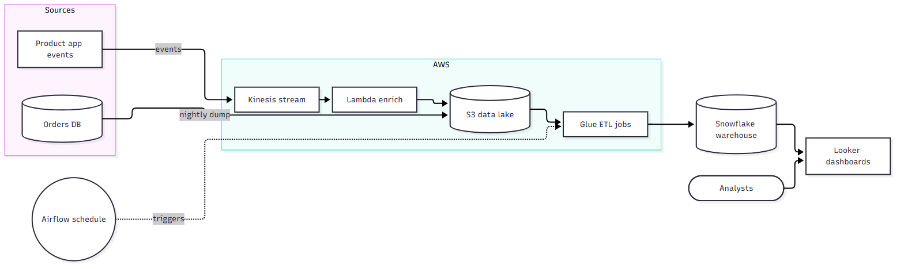
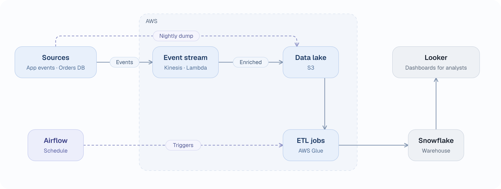
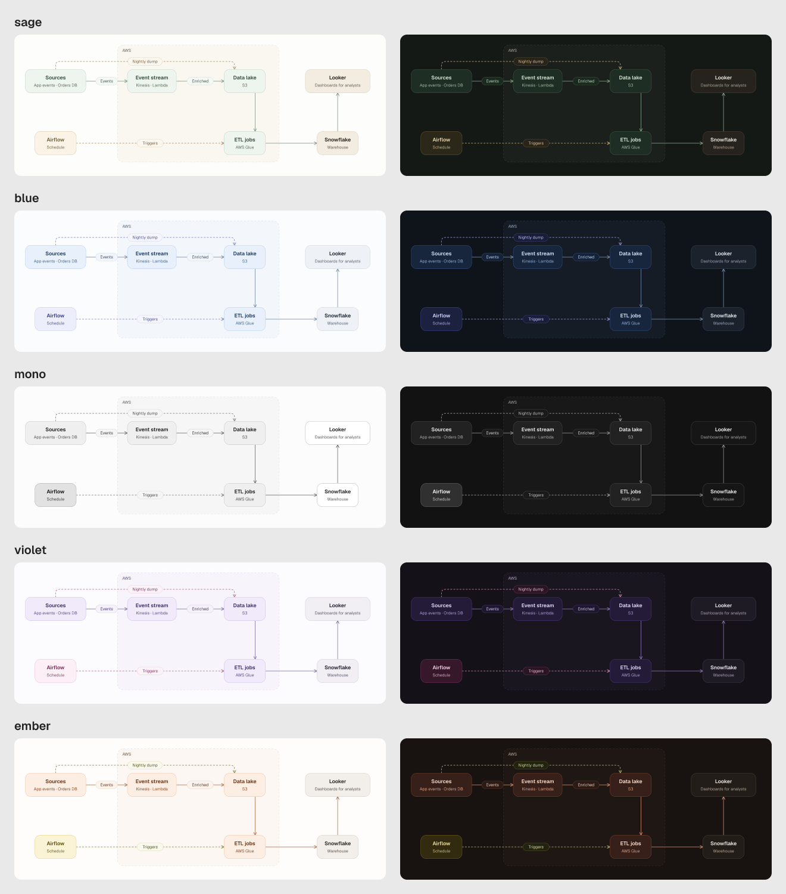

# diagram-polish

A [Claude Code](https://claude.com/claude-code) skill that turns plain diagrams, like the Mermaid block in a README, into clean ones with a look of their own.

## Quick start

```sh
claude plugin marketplace add ottuck/diagram-polish
claude plugin install diagram-polish@diagram-polish
claude plugin enable diagram-polish@diagram-polish   # only if it shows as disabled
```

Start a new session and ask: *"turn the Mermaid in the README into an architecture diagram."* Other ways to install, and using the script without Claude, are under [Install](#install).

**Before: Mermaid's default theme**

The look GitHub shows for a Mermaid code block:


The newer look of the current Mermaid CLI:



**After: this skill**

<picture>
  <source media="(prefers-color-scheme: dark)" srcset="skills/architecture-diagram/examples/from-mermaid/data-pipeline-dark.png">
  
</picture>

Mermaid is quick to write and rarely nice to look at: the layout is whatever the engine picks, labels sit in gray patches, and no two diagrams match. Give Claude the Mermaid, a description, or just the repo, and this skill redraws it.

- **It simplifies.** Ten or fourteen nodes become five to seven boxes (up to twelve when the system is tree-like and stays clean): pieces of one codebase are merged, duplicate arrows are joined, labels shrink to a word or two. It checks the code first, so nothing is drawn that doesn't exist.
- **It gives every diagram the same look.** Soft boxes, a dashed frame for what runs together, a different tone for services you don't run, dashed lines for scheduled or asynchronous work. Pick one of three themes, each with a dark variant. Hangul and CJK text work too.
- **It checks its own drawing.** The script stops on mistakes and warns about cut-off boxes, overlaps, lines through boxes and colliding labels. Claude then looks at the picture before handing it over.
- **It splits big systems instead of cramming them.** A picture holds five to seven boxes, up to twelve when the layout stays clean. A large platform becomes one overview of domains plus a detail diagram for each domain that matters, with matching names, so each picture stays readable.
- **Plain files in, plain files out.** The diagram is a small `diagram.json`; the script writes a standalone SVG (no dependencies) and, if you want, a 2x PNG.

## Install

```sh
cp -r skills/architecture-diagram ~/.claude/skills/         # every project
cp -r skills/architecture-diagram <project>/.claude/skills/ # one project
```

Start a new session, then ask: *"turn the Mermaid in the README into an architecture diagram."* The repo is also a plugin marketplace: `claude plugin marketplace add <owner>/diagram-polish`, then `claude plugin install diagram-polish@diagram-polish`. The manifests pass `claude plugin validate --strict`.

## Use the script alone

```sh
node skills/architecture-diagram/scripts/render.mjs diagram.json          # diagram.svg
node skills/architecture-diagram/scripts/render.mjs diagram.json --png    # + diagram.png (npm i -D @resvg/resvg-js)
node skills/architecture-diagram/scripts/render.mjs diagram.json --check  # validate, list box bounds, warnings
node skills/architecture-diagram/scripts/render.mjs diagram.json --check --strict  # same, exit code 1 on any warning (for CI)
```

Options: `--theme sage|blue|mono`, `--dark`, `--both`, `--auto` (see Dark mode), `--strict`, `--embed-fonts`, `--out`, `--title`, `--font-dir`, `--no-system-fonts`. The rules, the JSON format and what every field does are in [`SKILL.md`](skills/architecture-diagram/SKILL.md); [`starter.json`](skills/architecture-diagram/examples/starter.json) is a minimal file and [`diagram.schema.json`](skills/architecture-diagram/diagram.schema.json) a schema for your editor.

## Themes

Three themes, light on the left and dark on the right. Pick one with `"theme"` in the JSON or `--theme` on the command line:

- `sage` (default): green and sand
- `blue`: cool blue and slate
- `mono`: graphite grays, for print or docs that already have a color scheme



## Dark mode

Every theme has a dark palette. `--dark` draws it as `diagram-dark.svg`; `--both` writes the light and the dark file (with `--png`, both PNGs). Put them in a README with `<picture>`, so GitHub shows the one that matches the reader's theme:

```html
<picture>
  <source media="(prefers-color-scheme: dark)" srcset="docs/architecture-dark.svg">
  
</picture>
```

`--auto` writes one SVG that follows the OS setting through `prefers-color-scheme`; its PNG is the light one. That suits a page that opens the SVG on its own or inlines it. In an `` it follows the operating system, not a site's own light/dark toggle, so on GitHub or any site with its own switch use the two files and `<picture>`. The two README images above and the examples named `*-dark` and `starter-auto.svg` show it; the hero picture is a `<picture>` itself, so it switches if your GitHub is in dark mode.

## More examples

[`examples/from-mermaid`](skills/architecture-diagram/examples/from-mermaid) has six Mermaid sources with the diagram made from each: a Korean one, a 14-node shop merged down to seven boxes, a Supabase and Next.js app, a Unity WebGL game embedded in a web app, a login flow written as a *sequence* diagram (in the blue theme), and the pipeline above. [`examples/`](skills/architecture-diagram/examples) has six more, from the author's own projects.

## Limits: how big a system can be

The script doesn't lay out boxes or route lines. Claude picks every coordinate, so the picture is only as clean as that hand placement, and the checks (lines through boxes, two lines on the same path, `--strict`) catch mistakes but don't fix them. This sets the policy:

- **One picture holds five to seven boxes, up to twelve if it is tree-like.** Five to seven is what the rules and most examples are built for. A system with one hub or one flow can keep 8–12 boxes on a canvas up to 1280 wide, as long as `--strict` passes and no lines cross. The cost is smaller text: shown 860px wide, 12px notes come out around 8px. A trial with 30 boxes and 41 lines in a single picture gave 43 warnings and an unreadable result, so anything past twelve is drawn as a set.
- **A larger system is drawn as a set:** one overview of domains plus up to five detail diagrams, each again five to seven boxes. That covers roughly a few dozen components. Names must match between overview and detail; Claude is told to do that, but nothing checks it yet.
- **Past that, this is the wrong tool.** A platform with hundreds of services, or a diagram that must stay in sync with a model, needs a tool with automatic layout and one model behind many views. Claude will say what it left out and ask which domains you want, rather than cram them in.
- **Infrastructure topology is out of scope.** Network diagrams where containment is the point (region, VPC, availability zone, subnet with its CIDR, security groups) and where official cloud icons carry the meaning don't fit: groups are flat frames, every box looks alike, and the rules would merge the two availability zones into one box, which removes what the diagram is for. A trial of a two-zone AWS layout with 15 boxes drew, but without subnets, icons or the usual color coding of traffic. This tool is for logical architecture: what talks to what.
- **Not planned:** automatic layout or routing. It would cost the "SVG with no dependencies" property. A cross-diagram check of box names is the most likely next step.

These limits come from trial drawings and the rules in [`SKILL.md`](skills/architecture-diagram/SKILL.md); the overview-plus-detail flow itself hasn't been run on a real large repository yet.

## Notes

- Box widths are estimated for Geist, which the PNG uses. An SVG doesn't carry fonts: on a machine without Geist the browser draws Arial or similar, a little wider. `--embed-fonts` adds Geist to the SVG (about 340 KB per file) so it looks the same everywhere.
- In the PNG, Hangul and CJK text uses a system sans font (Malgun Gothic, Yu Gothic, Apple SD Gothic Neo or Noto Sans CJK) and bold may not apply to it.
- The two "before" images are `@mermaid-js/mermaid-cli` 10.9 and 12.0 with their default themes. Mermaid's look and layout change between versions and hosts; the point holds in all of them.

## License

MIT, see [LICENSE](LICENSE). The bundled Geist fonts are under the SIL Open Font License ([fonts/LICENSE.txt](skills/architecture-diagram/fonts/LICENSE.txt)).
