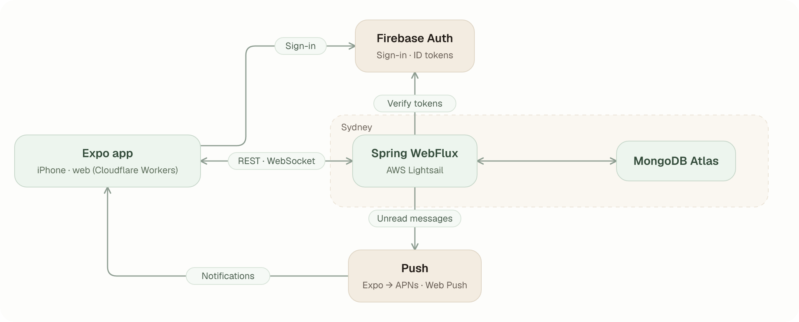
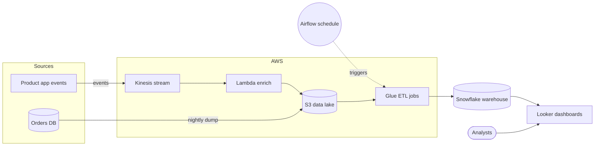
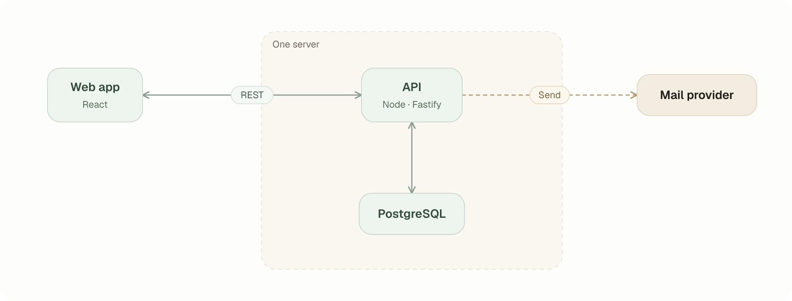
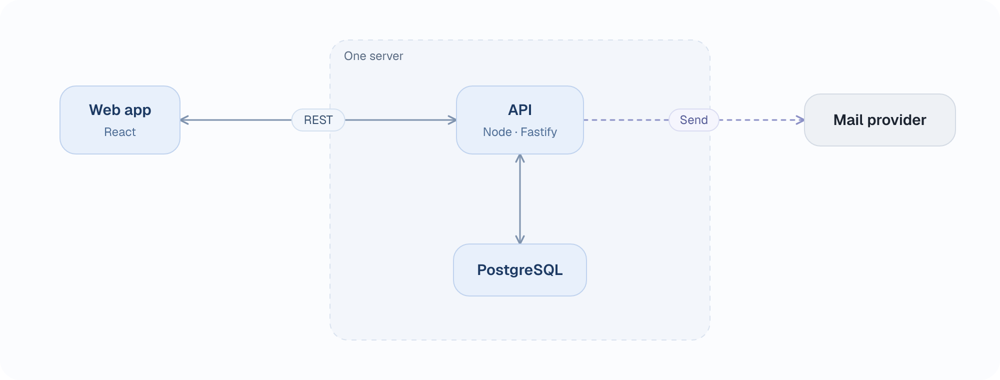

# architecture-diagram-skill

A [Claude Code](https://claude.com/claude-code) skill that redraws a project's architecture as a clean, consistent diagram.

You (or Claude) write the boxes and arrows in a small JSON file. A bundled script works out box sizes and line routes and draws a standalone SVG, and a 2x PNG if you want one. Nobody places pixels or picks colors by hand, so every diagram in a project looks the same.

<p align="center">
  
</p>

## What the skill does

Ask Claude something like *"turn the Mermaid in the README into an architecture diagram"* and the skill walks it through:

1. **Read** the source (Mermaid, README, your description) and check it against the code, so nothing is drawn that doesn't exist.
2. **Reduce** it to 5–7 boxes: merge same-codebase pieces, mark services you don't run as *outside*, frame things that run in one place, one arrow per pair, short labels.
3. **Write** `diagram.json` with box centers, edge routes and a one-sentence summary.
4. **Render and check.** The script stops on mistakes and warns about boxes cut off by the canvas, overlapping boxes, lines crossing a box, labels on top of each other, and boxes over a group's title. Claude then looks at the PNG before handing it over.

The rules live in [`skills/architecture-diagram/SKILL.md`](skills/architecture-diagram/SKILL.md). [`examples/`](skills/architecture-diagram/examples) has seven diagrams with their JSON, SVG and PNG.

## From Mermaid

<details open>
<summary>The Mermaid in a README</summary>



</details>

Ten nodes became seven boxes: Kinesis and Lambda merged into one stage, the two sources into one, and the analysts folded into the Looker box's note.

<p align="center">
  
</p>

More in [`examples/from-mermaid`](skills/architecture-diagram/examples/from-mermaid): a Korean Mermaid for a small server, a 14-node microservice shop merged down to seven boxes, and a Supabase and Next.js app. Each has the `.mmd` source, the `diagram.json`, the SVG and the PNG.

## Themes

`"theme": "sage"` (default) or `"theme": "blue"`, or `--theme blue` on the command line. A top-level `"colors"` object overrides single entries of either.

<p align="center">
  
  
</p>

## Install

Copy the skill folder where Claude Code looks for skills:

```sh
# for every project
cp -r skills/architecture-diagram ~/.claude/skills/

# or for one project only
cp -r skills/architecture-diagram <your-project>/.claude/skills/
```

Start a new session. The skill shows up as `architecture-diagram` and is used when you ask for an architecture diagram.

The repo also has a plugin manifest, so it should install through a plugin marketplace once it is published (`/plugin marketplace add <owner>/architecture-diagram-skill`, then install `architecture-diagram-skill`). That path has not been tested yet.

## Use the script on its own

Node 18 or newer. The SVG needs no dependencies.

```sh
node skills/architecture-diagram/scripts/render.mjs diagram.json          # writes diagram.svg
node skills/architecture-diagram/scripts/render.mjs diagram.json --png    # also diagram.png (2x)
node skills/architecture-diagram/scripts/render.mjs diagram.json --check  # validate only
```

`--theme sage|blue` picks the palette. `--png` needs [`@resvg/resvg-js`](https://github.com/yisibl/resvg-js) in the folder you run it from (`npm i -D @resvg/resvg-js`). It draws with the Geist fonts in `skills/architecture-diagram/fonts`; for Hangul, kana or Han text it also picks a system sans font (Malgun Gothic, Yu Gothic, Apple SD Gothic Neo or Noto Sans CJK). Other options: `--out <file.svg>`, `--title <name>`, `--font-dir <dir>` (extra `.ttf` files), `--no-system-fonts` (the same PNG on every machine). `--check` also lists every box's bounds, which helps when you place neighbors.

## The JSON

```json
{
  "title": "My App",
  "width": 1000,
  "height": 380,
  "summary": "Clients talk to one API server, which keeps data in Postgres and sends mail through a provider.",
  "groups": [{ "title": "One server", "x": 330, "y": 40, "w": 380, "h": 300 }],
  "nodes": [
    { "id": "web", "x": 120, "y": 120, "title": "Web app", "note": "React" },
    { "id": "api", "x": 520, "y": 120, "title": "API", "note": "Node · Fastify" },
    { "id": "db", "x": 520, "y": 270, "title": "PostgreSQL" },
    { "id": "mail", "x": 880, "y": 120, "title": "Mail provider", "tone": "outside" }
  ],
  "edges": [
    { "from": "web", "to": "api", "label": "REST", "both": true },
    { "from": "api", "to": "db", "both": true },
    { "from": "api", "to": "mail", "label": "Send", "dashed": true }
  ]
}
```

- A node's `x`, `y` is its **center**. Its width is computed from the text. A group's `x`, `y` is its **top-left corner**.
- `tone` is `main` (default), `accent` (people, triggers) or `outside` (services you don't run).
- Edges route themselves; `route`, `offset`, `fromOffset`, `toOffset`, `bend` and `labelAt` fix the awkward ones. [`SKILL.md`](skills/architecture-diagram/SKILL.md) explains each.
- [`diagram.schema.json`](skills/architecture-diagram/diagram.schema.json) is a JSON Schema for editor completion. A top-level `"colors"` object overrides single palette entries.

## Notes

- Text widths are estimated for Geist. With another font the boxes can look slightly loose or tight; the PNG uses Geist for Latin text so it always matches. Bold may not apply to Hangul/CJK in the PNG.
- The SVG lists Geist first and then common CJK sans fonts, so a browser shows Hangul and kana in a sans face too.
- The six larger examples are the author's own projects, drawn for a portfolio.

## License

MIT, see [LICENSE](LICENSE). The bundled Geist fonts are under the SIL Open Font License ([fonts/LICENSE.txt](skills/architecture-diagram/fonts/LICENSE.txt)).
