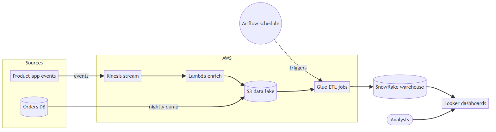

# architecture-diagram-skill

A [Claude Code](https://claude.com/claude-code) skill that turns plain diagrams, like the Mermaid block in a README, into clean ones with a look of their own.

**Mermaid's default render**



**After**


Mermaid is quick to write and rarely nice to look at: the layout is whatever the engine picks, labels sit in gray patches, and no two diagrams match. Give Claude the Mermaid, a description, or just the repo, and this skill redraws it.

- **It simplifies.** Ten or fourteen nodes become five to seven boxes: pieces of one codebase are merged, duplicate arrows are joined, labels shrink to a word or two. It checks the code first, so nothing is drawn that doesn't exist.
- **It gives every diagram the same look.** Soft boxes, a dashed frame for what runs together, a different tone for services you don't run, dashed lines for scheduled or asynchronous work. Pick `sage` or `blue`. Hangul and CJK text work too.
- **It checks its own drawing.** The script stops on mistakes and warns about cut-off boxes, overlaps, lines through boxes and colliding labels. Claude then looks at the picture before handing it over.
- **Plain files in, plain files out.** The diagram is a small `diagram.json`; the script writes a standalone SVG (no dependencies) and, if you want, a 2x PNG.

## Install

```sh
cp -r skills/architecture-diagram ~/.claude/skills/         # every project
cp -r skills/architecture-diagram <project>/.claude/skills/ # one project
```

Start a new session, then ask: *"turn the Mermaid in the README into an architecture diagram."* The repo also has a plugin manifest for `/plugin marketplace add`; that route is untested.

## Use the script alone

```sh
node skills/architecture-diagram/scripts/render.mjs diagram.json          # diagram.svg
node skills/architecture-diagram/scripts/render.mjs diagram.json --png    # + diagram.png (npm i -D @resvg/resvg-js)
node skills/architecture-diagram/scripts/render.mjs diagram.json --check  # validate, list box bounds, warnings
```

Options: `--theme sage|blue`, `--out`, `--title`, `--font-dir`, `--no-system-fonts`. The rules, the JSON format and what every field does are in [`SKILL.md`](skills/architecture-diagram/SKILL.md); [`starter.json`](skills/architecture-diagram/examples/starter.json) is a minimal file and [`diagram.schema.json`](skills/architecture-diagram/diagram.schema.json) a schema for your editor.

## Themes

<p>
  
  
</p>

## More examples

[`examples/from-mermaid`](skills/architecture-diagram/examples/from-mermaid) has four Mermaid sources with the diagram made from each: a Korean one, a 14-node shop merged down to seven boxes, a Supabase and Next.js app, and the pipeline above. [`examples/`](skills/architecture-diagram/examples) has six more, from the author's own projects.

## Notes

- Box widths are estimated for Geist, which the PNG uses. In the PNG, Hangul and CJK text uses a system sans font (Malgun Gothic, Yu Gothic, Apple SD Gothic Neo or Noto Sans CJK) and bold may not apply to it.
- The "Mermaid's default render" image is `@mermaid-js/mermaid-cli` 10.9 with its default theme, the lavender-and-yellow look GitHub shows for a ` ```mermaid ` block. Mermaid's layout differs a little between versions and hosts; the look is the same.

## License

MIT, see [LICENSE](LICENSE). The bundled Geist fonts are under the SIL Open Font License ([fonts/LICENSE.txt](skills/architecture-diagram/fonts/LICENSE.txt)).
